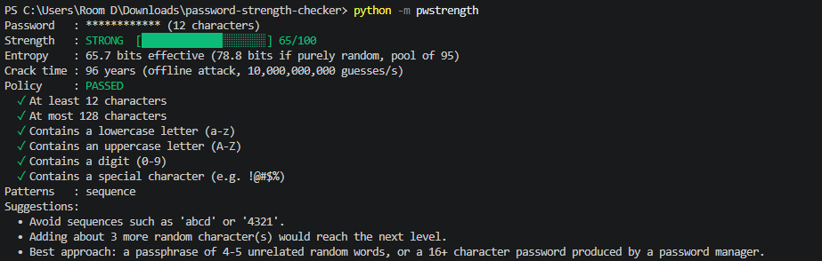
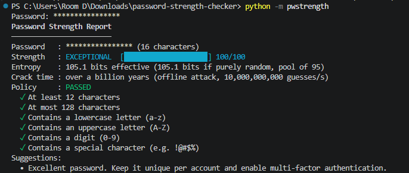
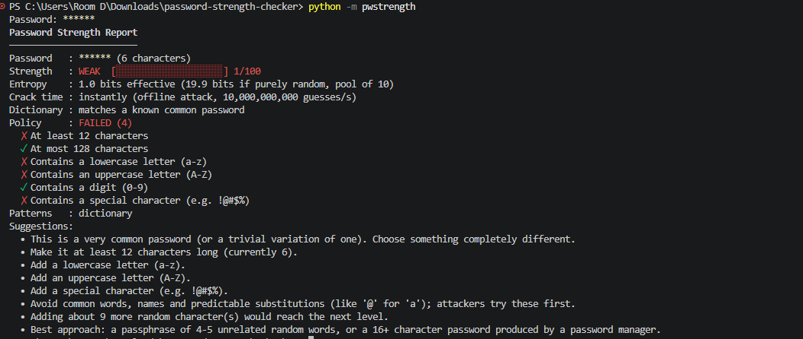
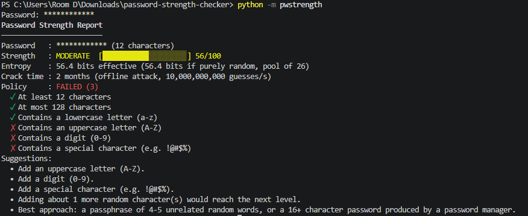
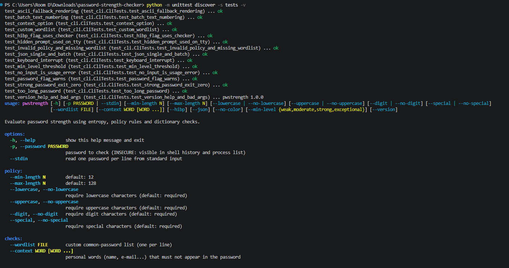
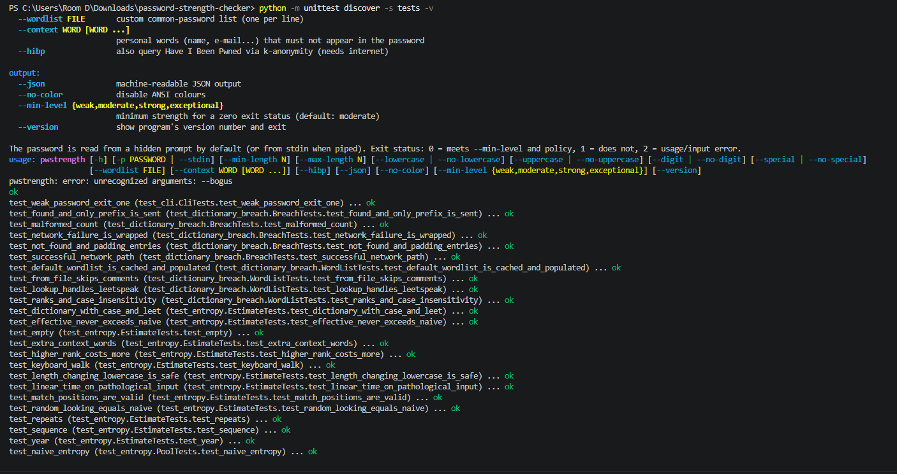
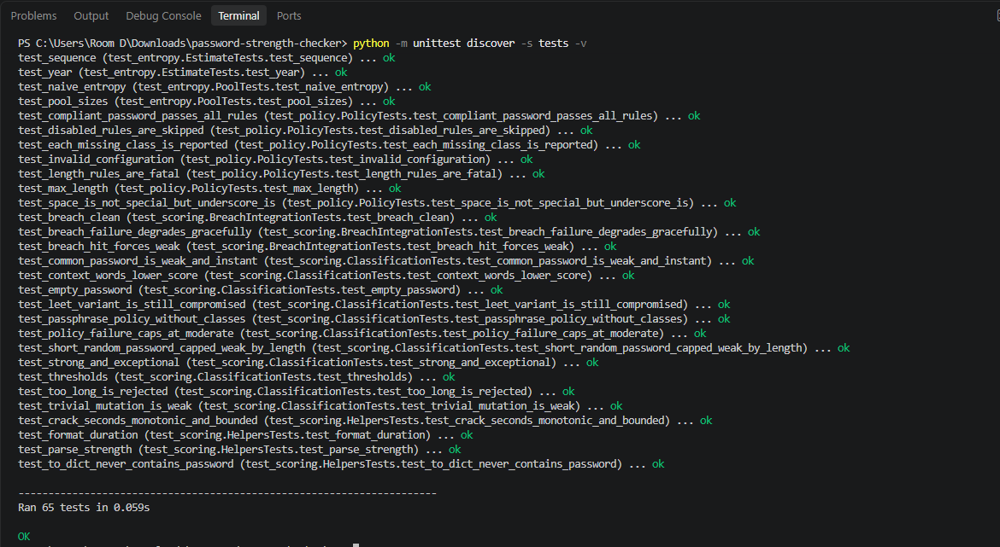
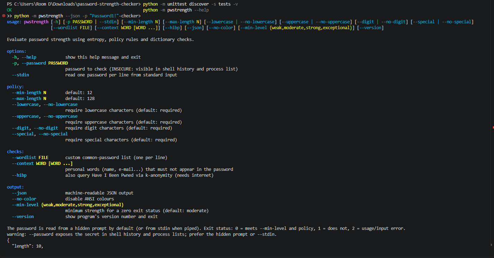
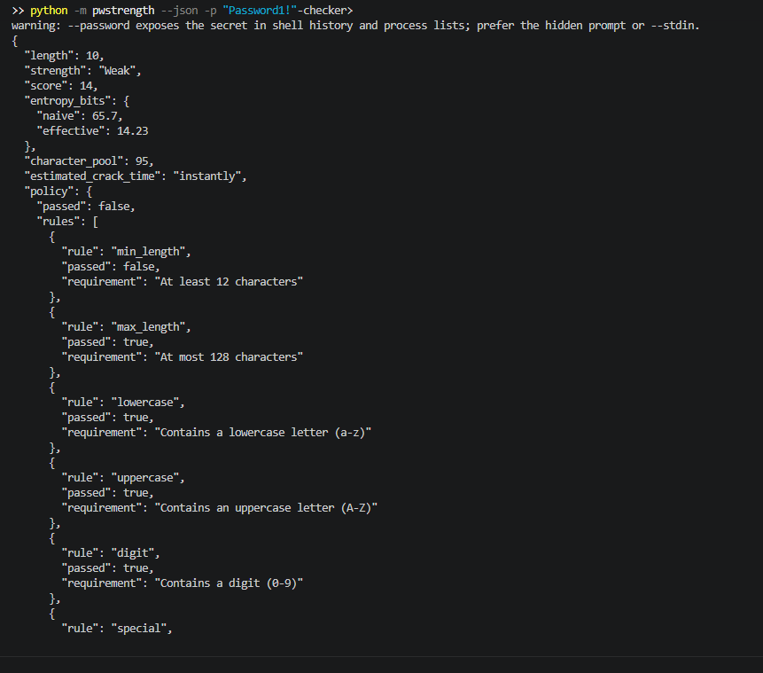
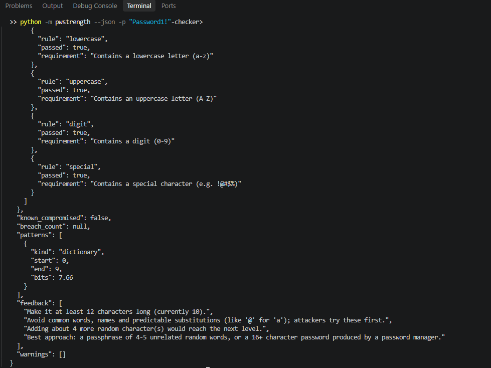

# Password Strength Checker (`pwstrength`)

A zero-dependency Python library and CLI that evaluates password strength using
**entropy estimation**, **configurable policy rules**, **dictionary/breach checks** and
produces a **Weak / Moderate / Strong / Exceptional** classification with **actionable feedback**.

* Python 3.10+, standard library only
* Fully typed (`py.typed`, `mypy --strict` clean), ruff clean, 99% test coverage
* The password is never printed, logged, stored or sent anywhere (the optional breach check sends only a 5-character SHA-1 prefix)

## Install & run

```bash
pip install .                 # or: pip install -e ".[dev]"
pwstrength                    # masked prompt: shows * per character (recommended)
echo 'MyP@ssw0rd' | pwstrength --stdin
python -m pwstrength --help
```

Without installing (Linux/macOS): `PYTHONPATH=src python3 -m pwstrength`.
Without installing (Windows PowerShell): `$env:PYTHONPATH="src"; python -m pwstrength`.

### Examples

```bash
pwstrength --stdin --json < passwords.txt          # batch, JSON array
pwstrength --min-length 16 --no-special            # custom policy (passphrases)
pwstrength --context alice alice@example.com       # penalise personal info
pwstrength --hibp                                  # also check Have I Been Pwned
pwstrength --wordlist rockyou-top100k.txt          # larger dictionary
pwstrength --min-level strong && echo "accepted"   # CI / scripts
```

**Exit codes:** `0` meets `--min-level` and passes the policy · `1` does not · `2` usage/input error · `130` interrupted.

Docker: `docker build -t pwstrength . && echo 'Secret123!' | docker run -i --rm pwstrength --stdin`

## Library use

```python
from pwstrength import PasswordAnalyzer, Policy

analyzer = PasswordAnalyzer(Policy(min_length=14))
result = analyzer.analyze("Tr0ub4dor&3", context=["alice@example.com"])
print(result.strength.label, result.score, result.effective_bits)
for tip in result.feedback:
    print("-", tip)
```

## Command-line output (screenshots)

Captured from a real run on Windows PowerShell. Typed characters are echoed as `*`; the password itself is never displayed.

| Strong | Exceptional |
|:--:|:--:|
|  |  |

| Weak | Moderate |
|:--:|:--:|
|  |  |

**Unit tests (65 tests, all passing)**





**Help and JSON output**





A plain-text transcript of additional runs is in [`docs/demo_output.txt`](docs/demo_output.txt).

## How it works

| Step | Module | What it does |
|------|--------|--------------|
| 1. Policy | `policy.py` | Length (min/max), lowercase, uppercase, digit, special-character rules. Each class rule can be disabled. |
| 2. Entropy + dictionary | `entropy.py`, `dictionary.py`, `breach.py` | Naive entropy `len x log2(pool)` and a **pattern-aware effective entropy**; dictionary lookups incl. case/leetspeak; optional HIBP check. |
| 3. Classification | `scoring.py` | `score = min(100, floor(effective_bits))` -> Weak `<40`, Moderate `<60`, Strong `<80`, Exceptional `>=80`. |
| 4. Feedback | `feedback.py`, `report.py` | Rule-specific fixes, pattern warnings, "N more characters to reach the next level", passphrase advice. |

### Effective entropy

Naive entropy overestimates anything non-random (`Password1!` has a 95-symbol pool but is trivially guessed).
The estimator finds the **cheapest way an attacker could construct the password** with a shortest-path
dynamic programme over the string (`O(n x W)`, `W <= 64`), choosing between brute force and:

| Pattern | Cost model |
|---------|------------|
| Dictionary word (>=4 chars, any substring) | `log2(rank+1)` + case bits + leetspeak bits |
| Sequence (`abcd`, `9876`) | `5 + log2(length)` |
| Keyboard walk (`qwerty`, `1qaz2wsx`) | `6.5 + log2(length)` |
| Repeat (`aaaa`, `abab`) | block brute-force cost + `log2(repeats)` |
| Year (1900-2099) | 7 bits |
| Anything else | `log2(pool)` per character |

Context words (name, e-mail parts) are treated as rank-1 dictionary words.

### Score caps (policy compliance)

* known-compromised password (dictionary or breach hit) **or** violated length rule -> at most **Weak**
* any other violated policy rule -> at most **Moderate**

Crack time assumes an offline attack at 10^10 guesses/s (fast hash on GPUs) and averages half the keyspace.

## Limitations (read before production use)

* The bundled dictionary is intentionally small (~340 entries) to keep the package light. For production,
  pass a large list with `--wordlist` / `WordList.from_file()` (e.g. top 100k-1M leaked passwords) and/or enable `--hibp`.
  Higher dictionary ranks translate into more realistic entropy figures.
* Entropy is an *estimate* of attacker effort, not a guarantee. Always combine with MFA and rate limiting.
* `--password` exposes the secret in shell history/process lists; prefer the prompt or `--stdin`.
* Inputs over 1,024 characters are rejected to bound CPU use.

## Development

```bash
make install     # editable install + dev tools
make test        # unit tests (65)
make lint typecheck coverage
make demo        # runs scripts/demo.sh, output in docs/demo_output.txt
```

## Project layout

```
src/pwstrength/   policy.py  entropy.py  dictionary.py  breach.py  scoring.py  feedback.py  report.py  cli.py
src/pwstrength/data/common_passwords.txt
tests/            65 unit tests (policy, entropy, dictionary/breach, scoring, CLI)
scripts/demo.sh   reproducible CLI demo
.github/workflows/ci.yml   Dockerfile   Makefile   pyproject.toml
```
